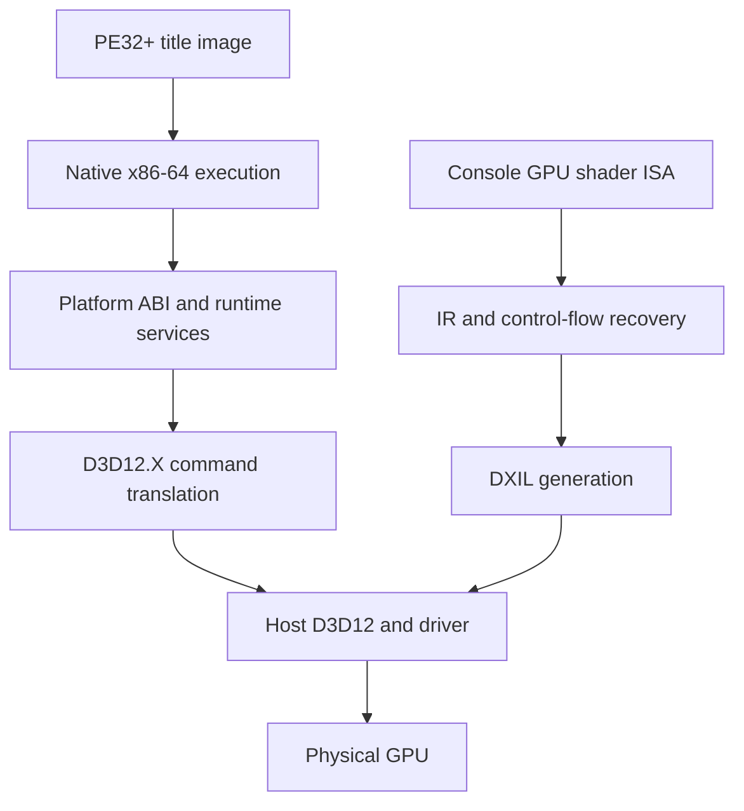

# NEPTUNE

native execution. native graphics. no full-system emulation.

NEPTUNE is an experimental x86-64 Windows compatibility and graphics runtime
derived from VIctory. the objective is a native PC execution path for Xbox
Series software, with the smallest platform translation layer that actually
works. the title's CPU code runs on the host processor; its console services,
GPU commands and shader programs require translation.

**development workspace, not a playable release.**

## machine path

The native CPU and shader translation paths converge at the host graphics API.



this is not a source-level port of the original game. it is a compatibility
runtime with native CPU execution and shader recompilation. not every console
API or GPU behavior is implemented. CPU-native execution is not proof of
correct rendering, security, or gameplay.

## current evidence

checkpoint: R41B, 2026-11-28. Executable evidence uses the R39F source baseline; R40A compares build profiles without changing release defaults. Windows 11 x64, Intel Core i5-12400F,
NVIDIA GeForce RTX 4060 8 GB. Rust 1.100.0.

| boundary | evidence |
| --- | --- |
| workspace regression | 686 passed, 0 failed, 40 ignored (exit 0) |
| source asset-policy check | 228 files passed in integrated regression |
| physical D3D12 two-flight publication | fence ordering verified on the test GPU |
| command-list retirement | fresh physical fixtures checked readback and completion |
| experimental AVX2 detiling | 24 held-out shapes matched scalar bytes; not default |
| CLI native entry point | two raw PE32+ fixtures returned distinct expected x86-64 results; two malformed/no-entry cases rejected |
| CLI console graphics ABI | strict IAT binding, valid memory-range witness and null E_INVALIDARG verified |
| Thin LTO | mixed CPU measurements; 520 passed, 0 failed, 40 ignored across formats, shader and GPU suites |
| actual title startup | user-reported R41A run reached menu, intro and credits; world rendering incorrect |
| real-game FPS / frame time | user-supplied R41A logs: menu near 30 FPS, lowest report 0.2 FPS, highest reported window mean 5731.8 ms; not a controlled A/B |
| long-session stability / VRAM peaks | not established |

R39C's synthetic AVX2 test measured up to 1.80x on a held-out CPU detiling
workload. some shapes regressed. this is not game FPS. the experimental
path stays disabled unless `VICTORY_DETILE_AVX2=1` is explicitly set.
unsupported CPU features and other layouts use the scalar path.

R38D's four-list admission bound is integrated. the bound is a count of
lists, not an exact memory limit. R39E fixes duplicate event ticks under concurrent waits. the
RED test observed four successful waits sharing tick 1; the corrected
implementation delivered four distinct ticks. eight further concurrent
rounds passed, together with seven GPU/worker fixture executions.
R39F adds process-lifetime heap worker stop, wake and join ownership.
The concurrent shutdown RED fixture falsely reported a live worker joined;
GREEN returns false for the second caller until the worker is joined.
Eight targeted executions passed on the integrated candidate, including
five physical GPU fixtures. Shutdown does not cover forced process
termination, and the wait budget does not bound arbitrary destructors.
Worker starvation and full title-level lifecycle are still open.
These are scoped tests, not an end-to-end gameplay or FPS result.

### native entry witnesses

R41A ran two hand-built PE32+ programs via the optimized runtime's actual
CLI and native entry point. The only code difference was one immediate byte.
The returned values were 23317927 and 23317926, respectively. A bind-only
run did not execute the entry point; a missing entry point and an invalid PE
signature were rejected.

R41B ran hand-built PE32+ import fixtures in strict mode, calling the
console graphics virtual-memory interface through the IAT. A valid
configuration returned a nonzero ordered address range; a null argument
returned HRESULT 0x80070057. This establishes the tested ABI path, not
GPU queue creation, rendering, or gameplay.

R40A Thin LTO showed mixed CPU microbenchmark results and zero readback
mismatches across 22 physical GPU copy fixtures. It remains experimental.
PGO has not been tested. No FPS comparison or playable release is claimed.

### local R42C experiment (not published source)

a user-run R41A session exposed long waits for title memory remapping,
dropped draws and incomplete world rendering. no gameplay pass is claimed.

R42C locally tests contiguous physical alias mapping in one host view
instead of one view per 64 KiB page. it is opt-in only. the controlled
Windows fixture with 32 pages and 128 remaps per sample measured a median
30.720 ms for the original path and 9.163 ms for the grouped path,
nine paired wins out of nine. the workspace regression was 687 passed,
0 failed and 41 ignored; an independent physical GPU copy fixture
returned 1 MiB with zero mismatches. these results are not game FPS.

the R42C implementation and executable are local candidate artifacts,
not part of the public branch. no new derivative code is published while
inherited source licensing remains unresolved.

### local R43 diagnostics checkpoint (not published source)

the legacy user directory contained 794 files but no persistent gameplay
trace. the existing tracing subscriber sent events only to stderr.
R43 adds a bounded per-process diagnostic log alongside stderr, with UTC
and monotonic timestamps, session and process identity, Rust thread IDs,
severity and subsystem. the default log directory is
`%LOCALAPPDATA%\NEPTUNE\logs`; `NEPTUNE_LOG_DIR` overrides it.
`NEPTUNE_LOG` takes precedence over the legacy `VICTORY_LOG`.
cache and persistent title data stay in their existing locations.

local verification: 689 workspace tests passed, 0 failed, 41 ignored.
a physical D3D12 copy fixture read back 1 MiB with zero mismatches.
a bind-only PE fixture produced four persistent tracing records.
the old user directory's 794 file hashes remained unchanged.

the log sink is synchronous, with a 64 MiB per-session limit and a
loss warning. stdout is not captured by this sink. the normal-return
footer does not establish successful title shutdown. gameplay logging
overhead, complete frame correlation, world rendering, pipeline
correctness and controlled gameplay FPS are still unverified.

the R43 implementation remains local. no new derivative code or
executable is published under the unresolved CC0-only licensing claim.

### local R44 pipeline boundary verification (not published source)

the stream parser previously accepted a zero-length description and did
not check the full size of known subobjects before reading their payload.
R44 locally validates the known prefix before decoding it. malformed
known extents return E_INVALIDARG. unknown subobject compatibility
behavior remains unchanged and is explicitly logged.

the focused regression covers 440 truncated lengths across four
subobject kinds and seven incomplete trailing headers, plus existing
valid-stream tests. GPU crate regression: 254 passed, 0 failed, 28 ignored.
a separate physical D3D12 fixture copied 1 MiB with zero mismatches.
these tests do not establish title pipeline creation or rendering parity.

the NVIDIA fork is a separate reference, not the NEPTUNE runtime.
frame generation throughput must not be reported as native FPS.
no new derivative source or executable has been published.

### local R45 diagnostic accounting (not published source)

the previous collector drained approximately every second but printed only
on a five-second reporting interval. R45 retains observations until the
report, bounds retained reason keys to 128 and each key to 512 bytes, and
counts overflow and reasons omitted from the top 40 separately. unknown
causes remain unknown. diagnostic observations are not unique draw counts.

local release workspace: 691 passed, 0 failed, 41 ignored. separate
physical RTX 4060 D3D12 copy fixture: 1 MiB, zero mismatches.
diagnostic pipeline tests: 6 passed. full diagnostic regression failed
with STATUS_ACCESS_VIOLATION in the profiler stack-walk test. isolated
R44 and R45 repetitions of that test passed 60,000 walks each; the
failure remains unresolved and is not attributed to the new collector.

no gameplay A/B, world-rendering parity or full CC0-only relicensing
claim. no new derivative source or executable distributed.

### local R46 native x64 unwind bounds (not published source)

a deterministic fixture exposed a saved-RBX read outside a 512-byte stack
copy: the previous guard accepted offset 512, width 8. R46 checks near
and far GPR/XMM save offsets, multi-slot operand lengths, and conservative
stack bounds before the OS unwinder. Eight focused cases passed.

local Windows release regression: 691 passed, 0 failed, 41 ignored.
GPU diagnostics regression: 276 passed, 0 failed, 27 ignored. Separate
profiler stress: 60,000 walks, 291,307 frames. Physical RTX 4060 copy
fixture: 1 MiB, zero mismatches. The earlier access violation is not
conclusively attributed to this defect; full stack-walk safety and
gameplay remain unverified. No performance improvement is claimed.

## tree

| path | purpose |
| --- | --- |
| `apps/victory` | native command line executable |
| `crates/victory-loader` | PE mapping, binding, execution |
| `crates/victory-hle` | console ABI and platform services |
| `crates/victory-gpu` | D3D12 objects, submission, memory, fences |
| `crates/victory-shader` | GPU instruction decoding, IR, DXIL generation |
| `crates/victory-formats` | texture layouts, detiling, codecs |
| `crates/victory-pipeline` | conversion and content-addressed cache |
| `crates/victory-pe` | executable and import-library inspection |
| `crates/victory-core` | configuration, logging, asset guards |
| `crates/victory-game` | title-specific interoperability |
| `xtask` | repository asset checks |

internal crate names, binary name and environment variables retain the
VIctory names for compatibility. no cosmetic rename of the ABI.

## build and verify

Windows x64. Rust toolchain pinned in [rust-toolchain.toml](rust-toolchain.toml).
D3D12 GPU with shader model 6.6; mesh shaders required for the world path.
hardware support is not a compatibility guarantee.

```powershell
cargo xtask install-hooks
cargo test --locked --release --workspace -- --test-threads=1
cargo build --locked --release -p victory
target\release\victory.exe --version
target\release\victory.exe --help
cargo xtask policy
```

add `--offline` to Cargo build and test commands when all dependencies are
already cached. ordinary synthetic tests do not require game files. ignored
tests are not passes; run the appropriate physical fixture separately.

For architecture and configuration see [architecture](docs/architecture.md)
and [example configuration](victory.example.toml).
Keep title files, cache and data outside the repository. the runtime is not
a security sandbox. do not execute untrusted images or use irreplaceable
original data as writable test input. use only files you are entitled to use.

## engineering rules

- fence completion before reclamation or descriptor publication
- bounded queues and explicit resource ownership
- actual native execution before a runtime claim
- scalar parity before ISA specialization; measure setup cost too
- no claimed speedup without paired measurements and raw samples
- preserve the known-good artifact and the rollback path
- no release label until rendering, gameplay, frame pacing and stability
  have been tested on hardware

R36 descriptor lifetime; R37 completion and retirement; R38 asynchronous
preparation; R39 SIMD; R40 build optimization; R41 integrated runtime.
A roadmap entry is not a completed feature.

## origin and license

NEPTUNE builds on [VIctory](https://github.com/Marvisak/VIctory) by Marvisak
and contributors, and the prior VIctory fork work. It is independent of
the original game's developers and publisher.

Preserved attribution from the inherited README:

- [VIctory](https://github.com/Marvisak/VIctory): loader, platform services,
  D3D12 backend, shader recompiler; GPL-3.0-or-later.
- [XCL](https://github.com/ivall/xcl): reference implementation, GPL-2.0-only;
  the inherited README describes its inspired fixes as written anew.
- myokex, [victory-amd](https://github.com/myokex/victory-amd) commit
  `c6dc4d8`, with contributions by Spexivus, joroyt and tightfall:
  memory-view guards; Joshua Odom, commit `10ea38e`: read-beside fix.
- inherited fork changes were developed with Claude Code, as recorded by
  the original author.

The [inherited README at R39C](https://github.com/redcubessockers/NEPTUNE/blob/7ed56c1f27d7f2237c2cc37f7ac810d574278a1c/README.md)
preserves the full credits, historical measurements and upstream notes.
Those measurements are not NEPTUNE results.

The repository's [LICENSE](LICENSE) label is CC0-1.0. The inherited
VIctory source and Cargo metadata still identify GPL-3.0-or-later.
The label alone does not establish permission to relicense inherited
code. CC0-only distribution of the full source is not established.
Third-party components retain their own licenses. This repository is intended for source and
synthetic tests, not distribution of game files or derived game assets.
See [asset policy](docs/asset-policy.md), including its inherited BCPack
table exception (not covered by the project license). An allowlist pass
is not independent rights clearance.

No game downloads or executable game distributions are provided here.
