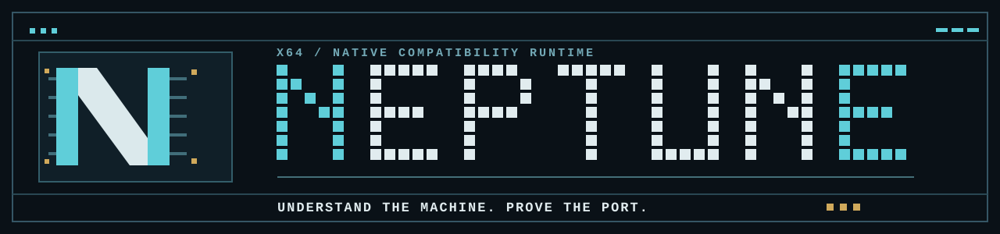
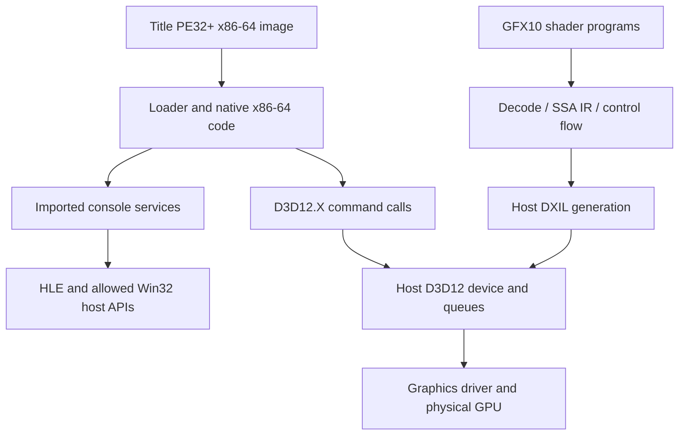

<p align="center">
  
</p>

<h1 align="center">NEPTUNE</h1>

<p align="center"><strong>NATIVE X86-64 · WINDOWS · D3D12 · SHADER RECONSTRUCTION</strong></p>
<p align="center"><code>THE BLACK SHEEP OF PC PORT ENGINEERING</code></p>

<p align="center">
  <a href="#machine-path">MACHINE PATH</a> ·
  <a href="#code-map">SOURCE MAP</a> ·
  <a href="#evidence-not-marketing">EVIDENCE</a> ·
  <a href="#build-and-check">BUILD</a> ·
  <a href="#the-release-wall">RELEASE GATE</a>
</p>

---

> [!CAUTION]
> **EXPERIMENTAL RUNTIME — NOT A PLAYABLE PC PORT.**
>
> This repository has native CPU, loader, platform-service, shader and D3D12 code. That does **not** establish complete API coverage, correct world rendering, title stability, or playable gameplay. The local R50 binary remains protected. The R52 unwind safety gate remains **BLOCKED**. Neither CI success nor GPU copy tests grant release approval.

```text
NEPTUNE//PROJECT STATUS                            2026-11-28

TARGET          Windows 11 / x86-64 / Rust 1.100.0
EXECUTION       native title x86-64 instructions
TRANSLATION     console ABI + D3D12.X + GFX10 shaders
GPU BACKEND     host D3D12
PRODUCTION      protected R50 checkpoint; not a public release
REVIEW          R54-R61 draft PR #2; isolated and not merged
R52             BLOCKED / full safety integration not verified
TITLE           NOT VERIFIED as fully playable
PERFORMANCE     UNKNOWN / no validated game FPS advantage
```

## Why this exists

Most of the hard work is **not** executing x86-64 instructions. The host CPU already understands them. The difficult boundary is everything those instructions expect around them: the executable image, imports, TLS, stack unwinding, console services, GPU command encoding, shader ISA, resource ownership, cache coherency and timing.

NEPTUNE derives from [VIctory](https://github.com/Marvisak/VIctory). Its objective is a narrowly scoped **native Windows compatibility runtime** for Xbox Series software, not full-system CPU emulation and not a source-code reimplementation of the title.

**"bare-metal style" means observing actual bytes and machine interfaces.** It does not mean bypassing Windows. The host operating system, D3D12 runtime and driver remain real dependencies.

## Machine path



The loader prepares an image for the Windows loader, maps title DLLs, resolves imports, initializes TLS and enters the native code path. Console calls are handled by HLE, selected host APIs or known title DLLs. Unknown calls are reported through generated stubs; pretending they succeeded is not compatibility.

Shader work passes through instruction decoding, intermediate representation, control-flow recovery, resource tracing and host DXIL emission. Command translation and shader conversion meet at host D3D12. Both can still be wrong on actual workloads.

See [architecture](docs/architecture.md) and the [engineering contract](docs/ENGINEERING-CONTRACT.md).

## Code map

| Source | What is actually there | Proof boundary |
| :--- | :--- | :--- |
| [`apps/victory`](apps/victory) | CLI for inspect, census, convert, run | CLI execution is not a gameplay claim |
| [`victory-pe`](crates/victory-pe) | read-only PE32+ and COFF import analysis | input parsing and ABI fixture tests |
| [`victory-loader`](crates/victory-loader) | mapping, relocations, TLS, imports, native entry, crash paths | Windows x64 process and unwind witnesses |
| [`victory-hle`](crates/victory-hle) | console service implementations and host pass-through | each resolved function and result |
| [`victory-gpu`](crates/victory-gpu) | D3D12.X objects, queues, fences, memory and command translation | ordering, lifetime and GPU readback |
| [`victory-shader`](crates/victory-shader) | GFX10 decode, IR, resource tracing and host shader generation | differentiated shader output and GPU behavior |
| [`victory-formats`](crates/victory-formats) | texture layout/detiling and codec handling | byte-exact data and boundary cases |
| [`victory-pipeline`](crates/victory-pipeline) | deterministic converters and content-addressed cache | cache identity and reproducibility |
| [`victory-game`](crates/victory-game) | title-format glue and build identity interfaces | `KNOWN_BUILDS` is empty in public baseline |
| [`victory-core`](crates/victory-core) | configuration, logging and asset guards | filesystem / config invariants |
| [`xtask`](xtask) | asset-policy enforcement and Git hooks | source files remain inside allowlist |

The inherited `victory-*` crate and binary names remain intentional. A cosmetic rename must not invalidate ABI references, paths, scripts or forensic history.

## Evidence, not marketing

The lanes below refer to **different artifacts**. They are not a cumulative pass count.

| Check | Observed evidence | Status |
| :--- | :--- | :--- |
| Public baseline source | 9 platform/title crates, Rust 1.100.0 manifest, Windows/D3D12 backend | **SOURCE OBSERVED** |
| Native PE entry | older R41 synthetic PE32+ fixtures entered native code and returned distinct values | **HISTORICAL FIXTURE PASS** |
| Physical D3D12 fixtures | R58 review-branch tests on RTX 4060, adapter `10de:2882`, with explicit GPU readback | **SCOPED HARDWARE PASS** |
| R54 worker lifecycle | native RED/GREEN witness retains join failure after a panicking worker | **SCOPED NATIVE PASS** |
| R61 Windows CI | strict Clippy, diagnostics, isolated worker and workspace/GPU test steps on PR head `5fd1866f` | **PASS ON THAT COMMIT** |
| R52 stack unwind | installed RPCRT4 bytes and native bounded-unwind counterexamples recorded | **WITNESS VERIFIED / INTEGRATION BLOCKED** |
| R52 corrected safety runner | published for review, but fresh host staging encountered `c0000043` | **NOT TESTED** |
| Actual title world rendering | historical user session reported incomplete rendering | **NOT VERIFIED** |
| Real gameplay, frame-time A/B, long session | no complete current release-bound proof | **NOT TESTED** |
| Vulkan backend / universal GPU support | no implementation or multi-vendor parity established | **UNKNOWN / NOT CLAIMED** |

**Exact evidence:** [R54–R61 review PR #2](https://github.com/redcubessockers/NEPTUNE/pull/2) · [Windows CI run 46137964800](https://github.com/redcubessockers/NEPTUNE/actions/runs/46137964800) · [historical engineering journal](docs/ENGINEERING-JOURNAL.md).

> [!IMPORTANT]
> GitHub-hosted Windows CI is **not** a physical RTX 4060 test. A physical-GPU fixture is **not** an actual title session. A past benchmark is **not** evidence of current HEAD performance.

### R52 / the first fault

The native investigation isolated a suspicious PC in the installed Windows RPC library:

```text
RPCRT4.dll     version 10.0.26100.1
RVA 0x589BF    41 5C 5F 5B C3
RVA 0x589C0       5C 5F 5B C3
FUNCTION       0x587E6 .. 0x589C3
UNWIND         chained metadata
OLD INVALID    0xC0000005 / access violation
BOUNDED        0xC0000028 / STATUS_BAD_STACK
```

The invalid PC starts at byte two of `POP R12`. A controlled old unwinder path faults; the bounded Windows API fails closed in that synthetic fixture. This does **not** prove the title executed an invalid PC or prove the entire profiler is now safe. The integrated R52 safety gate stays blocked. [Detailed R61 evidence](https://github.com/redcubessockers/NEPTUNE/blob/work/r54-worker-panic-join/docs/R61-UNWIND-SAFETY.txt).

## Build and check

**Host:** Windows x64 with MSVC build tools. The workspace pins [Rust 1.100.0](rust-toolchain.toml). Ordinary source and synthetic tests do not require proprietary game data.

```powershell
git clone https://github.com/redcubessockers/NEPTUNE.git
cd NEPTUNE

# Source policy and reproducible tests
cargo xtask policy
cargo clippy --workspace --all-targets --locked -- -D warnings
cargo clippy --workspace --all-targets --all-features --locked -- -D warnings
cargo test --workspace --locked --exclude victory-gpu
cargo test -p victory-gpu --locked -- --test-threads=1

# Native CLI (the inherited executable name)
cargo build --release --locked -p victory
.\target\release\victory.exe --help
```

Ignored tests must be selected explicitly and run under their documented native/physical preconditions. Use the [example configuration](victory.example.toml), keep game files and generated data outside the repository, and never use untrusted executables as if this were a security sandbox.

For the R54–R61 **review branch only**, `tests/physical-d3d12.ps1` records isolated hardware fixtures and `tests/r52-unwind-gate.ps1` defines an additional R52 validation harness. Neither script's existence means its entire gate passed on every machine.

## Hardware-aware, not instruction-aware

`REP MOVSB`, `REP STOSB`, `AVX2`, `BMI2`, `POPCNT`, non-temporal stores, prefetch and TSC timing are candidates, not accomplishments. Each experiment must establish CPU feature detection, scalar fallback, alignment, real workload, raw samples and measured regression tails.

A fast synthetic detile loop may improve a kernel and still worsen frame pacing. Only paired physical gameplay traces with a known-good baseline may support a frame-time performance claim.

## The release wall

| Gate | Current disposition |
| --- | --- |
| Review-branch source CI | **PASS** on R61 PR commit `5fd1866f`; not inherited by this branch |
| R50 protected executable | **PROTECTED** — preserve existing SHA-256 and rollback |
| R52 corrected runner / integrated diagnostics | **BLOCKED** until native replay and full safety tests |
| Resource lifetime and render parity on title | **NOT VERIFIED** |
| Actual gameplay / stability / 1% and 0.1% low | **NOT TESTED** |
| License provenance and distribution rights | **UNRESOLVED** |
| Production merge or playable binary release | **BLOCKED** |

R50 native checkpoint hash recorded by prior machine verification:

`fc3c8f9be91bc81140c60ed1023698fb21843947997dbd1e0471b86e3b119f0a`

R62 branding and documentation changes live on a **separate review branch**. They do not touch the local R50 checkpoint, GAME or the production source. Rollback is to discard this review branch; no deployment or forced file replacement is part of this work.

## Origin, rights and research

NEPTUNE builds on [VIctory](https://github.com/Marvisak/VIctory) by Marvisak and contributors. Related research includes [XCL](https://github.com/ivall/xcl) and the [victory-amd fork](https://github.com/myokex/victory-amd). It is not affiliated with the original title developer or publisher. Full upstream attributions and historical experiments remain in the [engineering journal](docs/ENGINEERING-JOURNAL.md).

> [!WARNING]
> The root [LICENSE](LICENSE) contains **CC0-1.0**, while inherited crate metadata declares **GPL-3.0-or-later**. The root label alone does not grant permission to relicense inherited code. The original BCPack tables have a separate rights exception. Publication clearance is **not established**.

Do not commit any title-derived files, binary excerpts, code dumps, shaders, textures, images or screenshots. The only original graphic in this documentation is the static, repository-authored SVG. See [asset policy](docs/asset-policy.md).

---

<p align="center"><strong>UNDERSTAND THE MACHINE. CONTROL THE BOUNDARY. RECONSTRUCT THE BEHAVIOR. PROVE THE PORT.</strong></p>
<p align="center"><code>NO GUESSWORK · NO FAKE COMPATIBILITY · NO FALSE PASS</code></p>
